# Alcooltest

[](https://github.com/nabz0r/AlcooholTest/actions/workflows/ci.yml)

**A world within.** An open-source, self-hosted spirits atlas: an editorial photographic arrival, botanical sculptures, original generative sound, traceable ingredients and an editorial notebook.

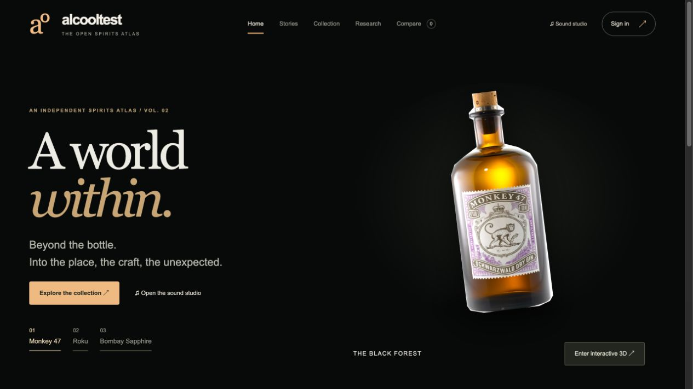

## Run locally

Install Docker Engine/Desktop with Compose v2 and Python 3, then:

```sh
git clone https://github.com/nabz0r/AlcooholTest.git
cd AlcooholTest
./scripts/bootstrap.sh
```

Open **http://localhost:8088**. Choose Set up instance, retrieve your one-time token with `./scripts/setup-token.sh` and create the first administrator. No default password is shared. Generated `.env` and local secrets are ignored by Git. Only the website binds to loopback; PostgreSQL and Redis have no published host port.

After installation, catalogue editing, duplicate resolution, contributions, moderation, price entry, public-provider discovery, study harvesting, imports and snapshot generation are accessible from the UI. SQL/media recovery remains an operator procedure. Public hosting requires HTTPS and a deployment/security review.

## Explore

- **55 canonical products + 2 distinct editions**, including Suntory, major houses and smaller distilleries. Root products appear once; formats, markets and sellers are not inflated into product identities.
- **22** locally hosted licensed reference photographs with provenance; explicit illustrations where a reliable licensed image is absent. A reference photo may show a different size, market or historical label. Front/rear/details tabs, zoomable inspection and moderated member uploads preserve provenance. The Heering record includes an actual historical front/rear pair; most rear labels remain undocumented.
- An editorial homepage with origins/craft/sound tabs, a separate collection, filters, ingredient search, comparison of four products, private shelves, community proposals and moderated **0–5 monkey** ratings with optional aroma, taste, finish, value, design, serving context and buy-again preference.
- Product pages with source-linked origin, historical/cultural editorial text, market bottlings, recipe disclosures, critic perspectives and a dated price notebook. The expanded collection intentionally leaves unverified specifications and secret recipes unknown.
- Interactive procedural **Studio 3D**, botanical explosion with eight plants per group and spread control, camera orbit/pan/zoom/reset/fullscreen, and an abstract **Neuro atlas** linked to research mechanisms. These are artistic reconstructions, not scans or measured brain activity.
- Opt-in **original botanical soundscapes**: identity-seeded pentatonic music, floral sine timbres, spice textures and citrus bells. A visible mixer exposes Play/Pause, master volume, three layers, speaker test, output meter and a 20-second WAV export. Off by default; no microphone, external audio, telemetry or automatic playback.
- Source-linked research with study design, population, findings and limitations; private empirical state-transition notebooks with null for unobserved rows. No product-specific pharmacological claims or intoxication forecasts are fabricated.
- Real executed Wikidata and PubMed JSONL discovery dumps. They are bounded, unverified provider snapshots, not “all public bottles”. Accept a candidate by linking it to an existing product, or verify a new draft before publishing.

- Direct, server-rendered product URLs, canonical metadata, Open Graph, JSON-LD, sitemap and robots support. Private pages stay noindex.

## A tour in screenshots

Actual captures from the local Docker build. [All 18 views, captions and integrity manifest](docs/SCREENSHOTS.md). Admin/member screens use a disposable QA account; no demonstration review was published.

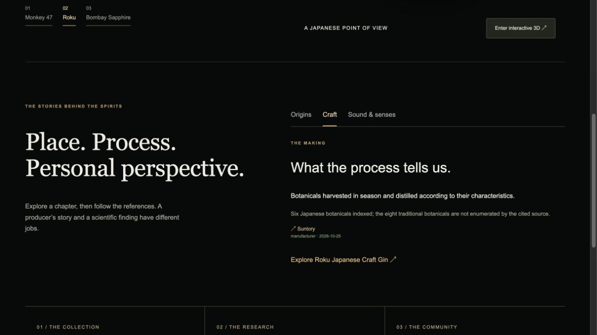

| | |
|---|---|
| **Collection overview**<br>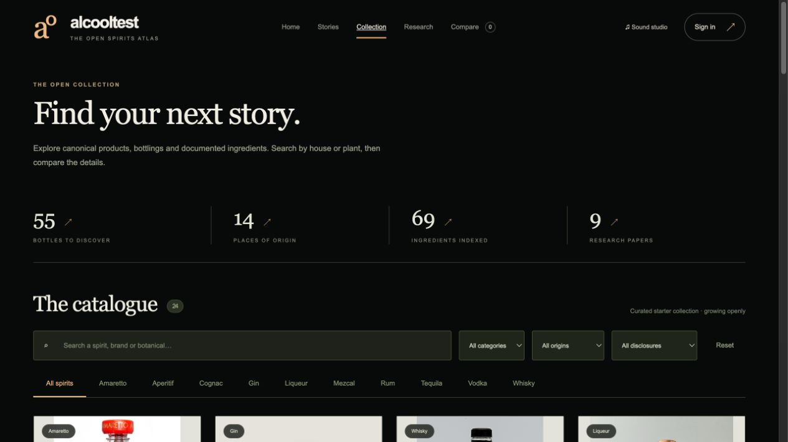 | **Browse the collection**<br>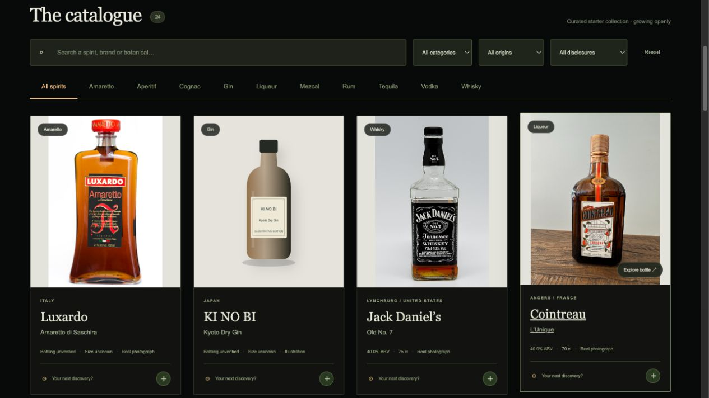 |
| **Product identity**<br>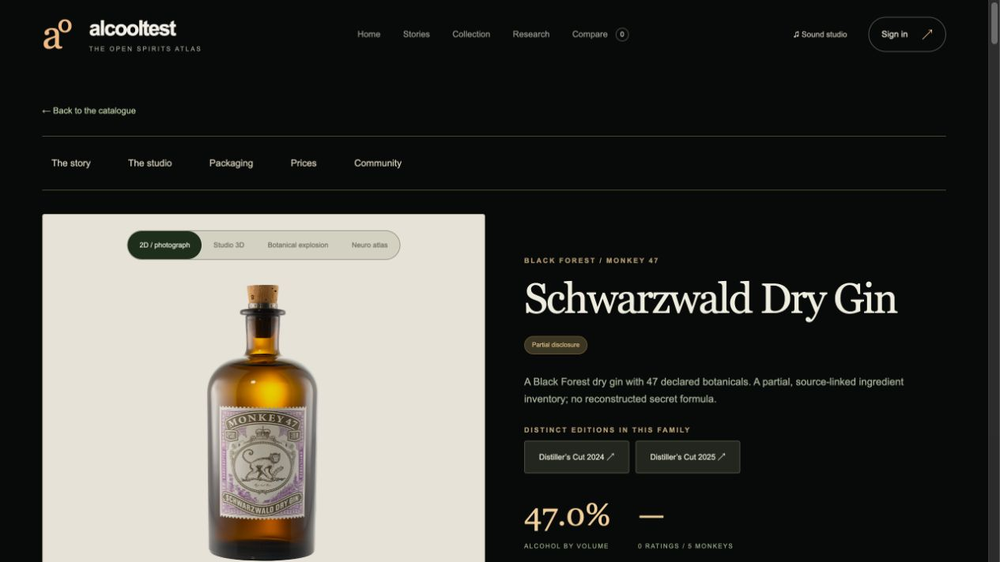 | **Botanical explosion**<br>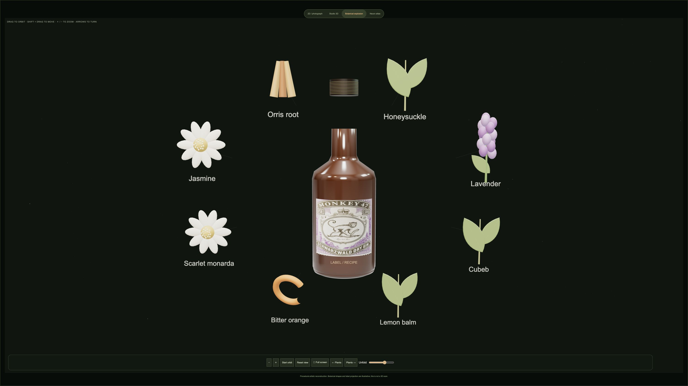 |
| **Neuro atlas**<br>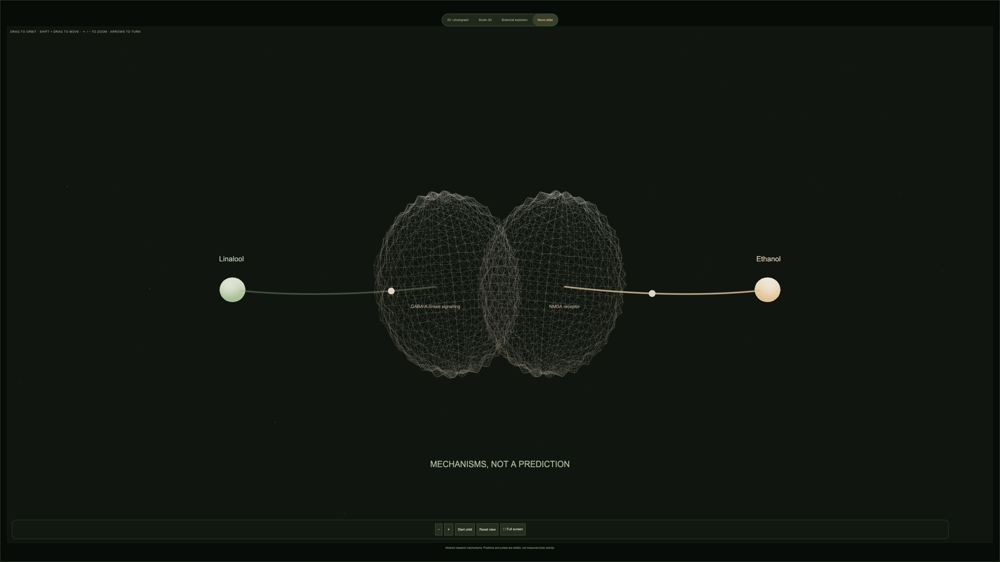 | **Sound studio**<br>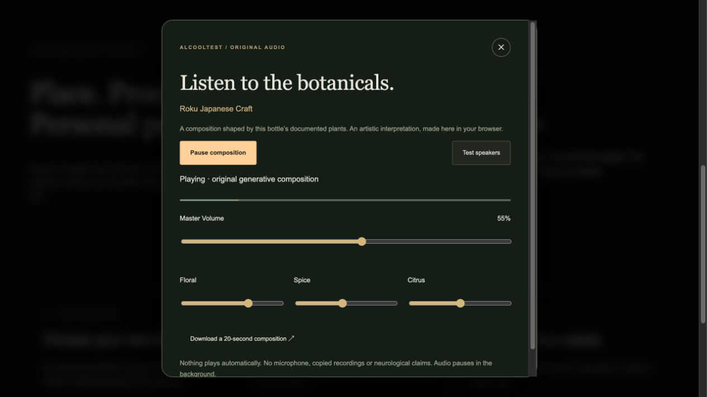 |
| **Price notebook**<br>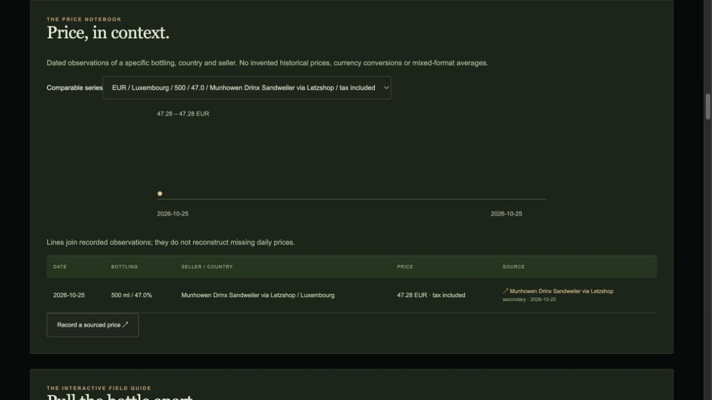 | **Real reverse packaging**<br>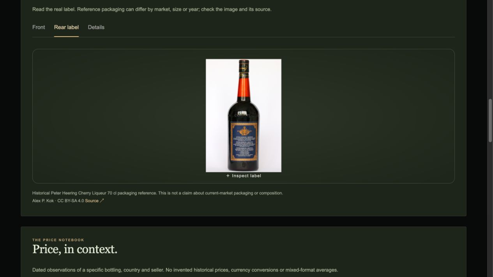 |
| **Label inspection**<br>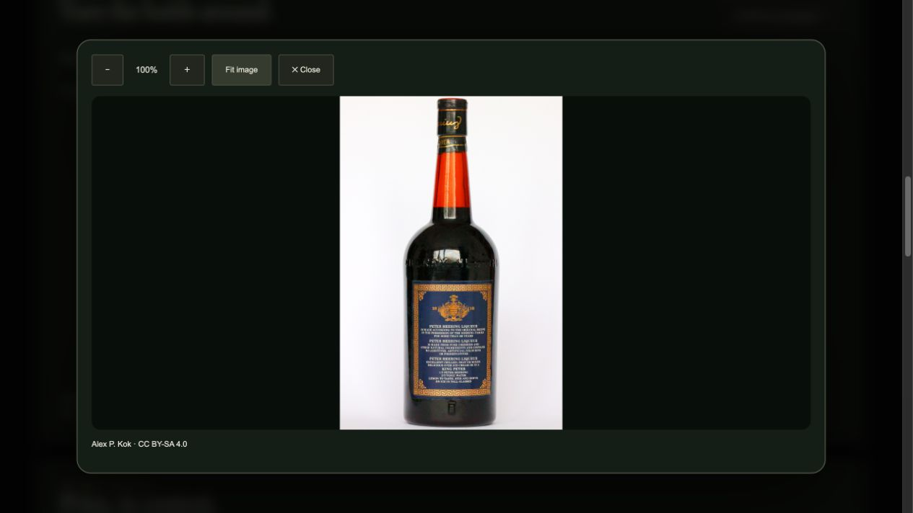 | **Detailed monkey review**<br>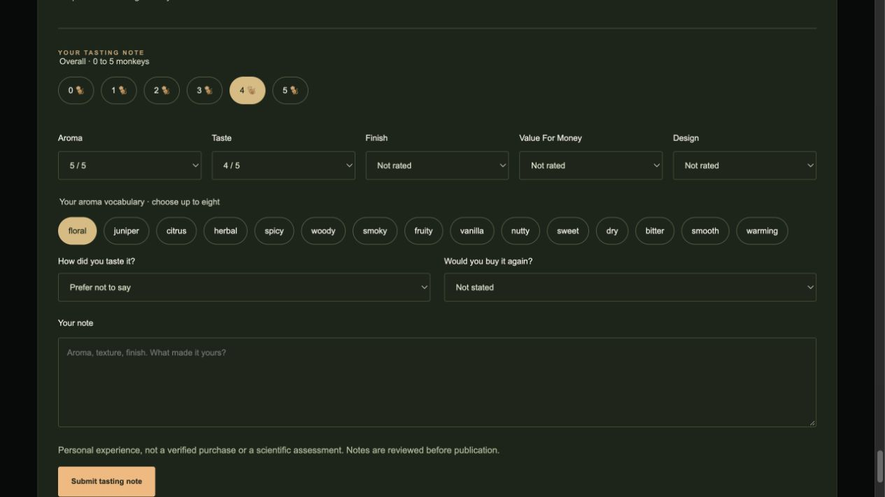 |
| **Photo contribution**<br>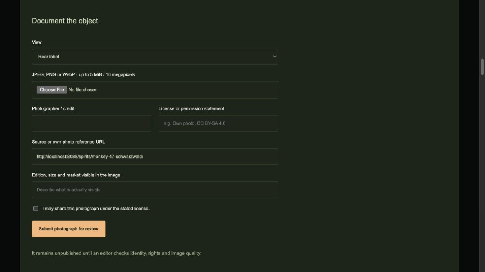 | **Editorial operations**<br>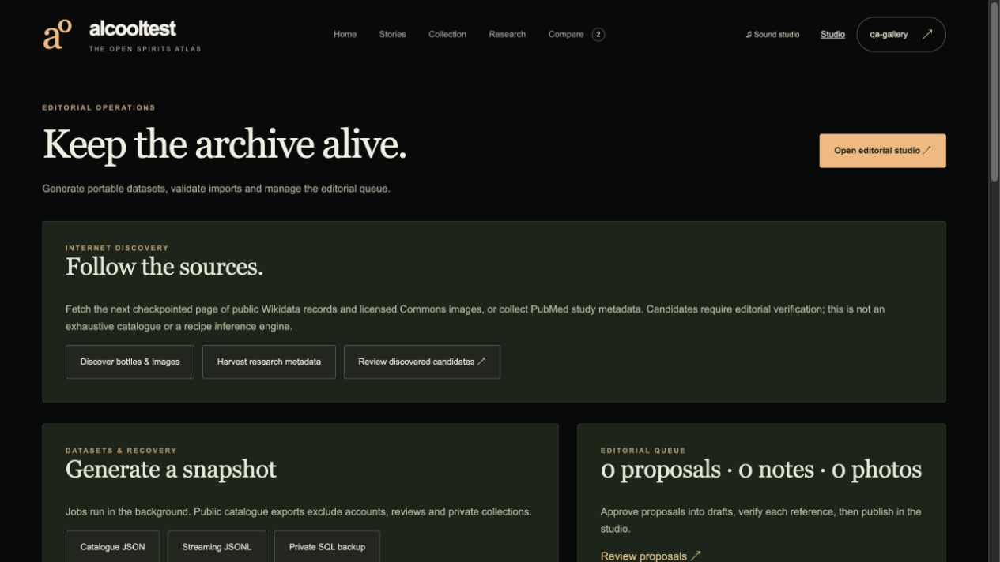 |
| **Administration**<br>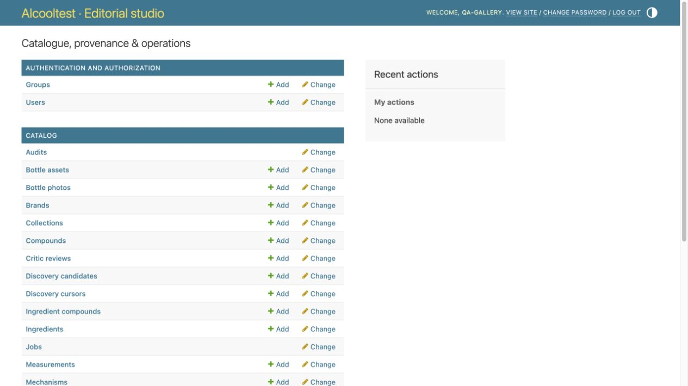 | **Duplicate resolution**<br>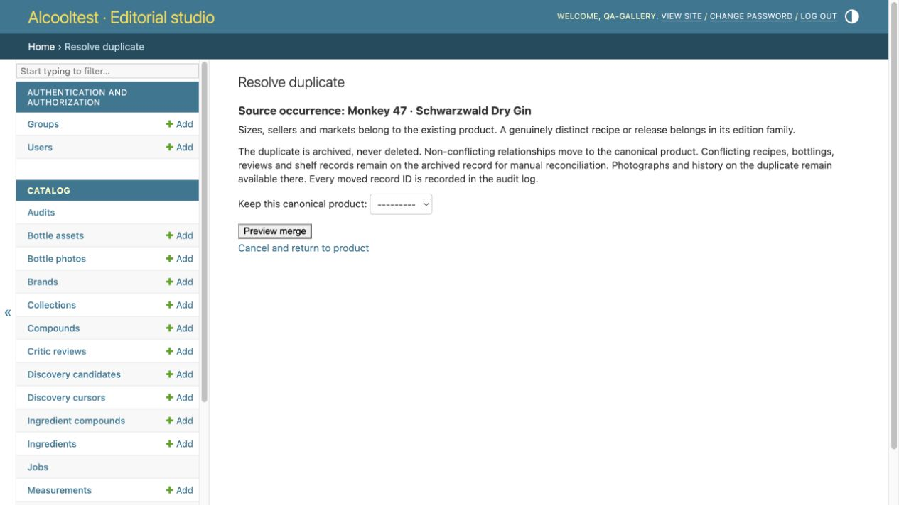 |
| **Research library**<br>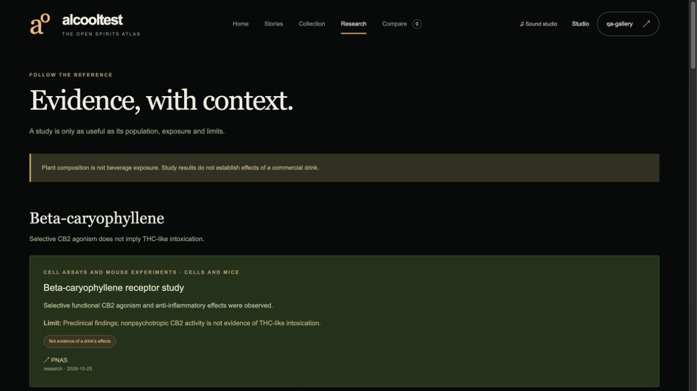 | **Side-by-side discovery**<br>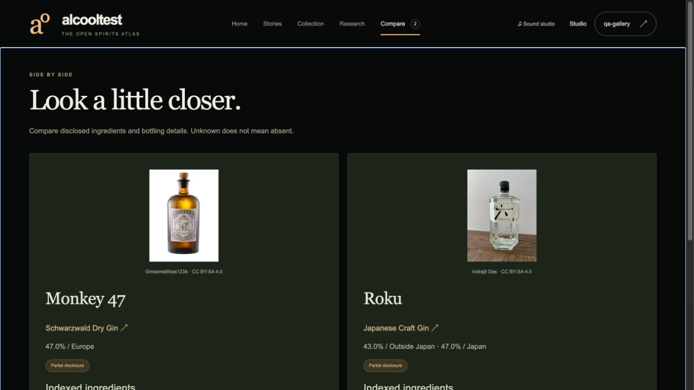 |

## Architecture

Django 5.2 LTS / PostgreSQL 17 / Redis 8 / TypeScript / Three.js / Nginx. Compose includes migration/static initialization, API, durable PostgreSQL-backed background worker, database, cache and static proxy. Read-only application filesystems, unprivileged application users, CSRF/session authentication, Argon2, rate limits and an audit trail supply a practical baseline. Public reads are revision-cached; imports are transactional UUID upserts; exports stream a consistent snapshot.

Source code is GPL-2.0. Original catalogue work is CC0 where indicated; photographs retain their own licenses and trademarks. Redis 8 offers an AGPLv3 open-source licensing option; review all dependency licenses for your deployment. No proprietary runtime or paid API is required. “Perfect”, certified WCAG compliance and post-quantum protection are not claimed; SSO and hybrid PQ TLS are documented deployment roadmaps.

## Data and operations

`data/catalog/seed.json`, `catalog.jsonl`, `schema.json` and `manifest.json` are reproducible distribution artifacts. `data/assets.json` records photo rights and checksums. `data/discovery/` contains executed public-provider dumps. Public catalogue exports exclude accounts, private observations, reviews, collections and member-uploaded photographs. Private SQL backups contain account data and password hashes; secure them and back up media separately.

```sh
# Explicit reseed updates seed UUIDs; ordinary restarts preserve editorial changes.
docker compose exec api python manage.py seed
# Run the test suite against PostgreSQL.
docker compose exec api python manage.py test catalog --noinput
# Rebuild the curated distributions after source edits.
python3 scripts/build_seed.py
python3 scripts/build_data_exports.py
# Re-fetch pinned photo bytes, rejecting changed hashes.
python3 scripts/fetch_assets.py
```

## Documentation

- [Initial analysis](docs/ANALYSIS.md), [Architecture](docs/ARCHITECTURE.md), [API](docs/API.md)
- [Design direction](docs/DESIGN.md), [Complete experience guide](docs/EXPERIENCE.md), [SEO and routes](docs/SEO.md)
- [Screenshot index](docs/SCREENSHOTS.md), [Work tracking](PROGRESS.md), [Delivery plan](PLAN.md)
- [Product identity and duplicate resolution](docs/IDENTITY.md)
- [Internet discovery and study harvesting](docs/INGESTION.md)
- [Science and Markov notebook](docs/SCIENCE.md), [Price history](docs/PRICES.md)
- [SSO and post-quantum roadmap](docs/SSO-PQC.md)
- [Data contracts](docs/DATA.md), [Operations and recovery](docs/OPERATIONS.md)
- [Validation and limits](docs/VALIDATION.md), [Photo attribution](docs/ATTRIBUTIONS.md)
- [Security](SECURITY.md), [Contributing](CONTRIBUTING.md)
