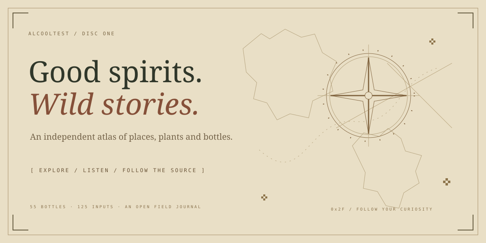
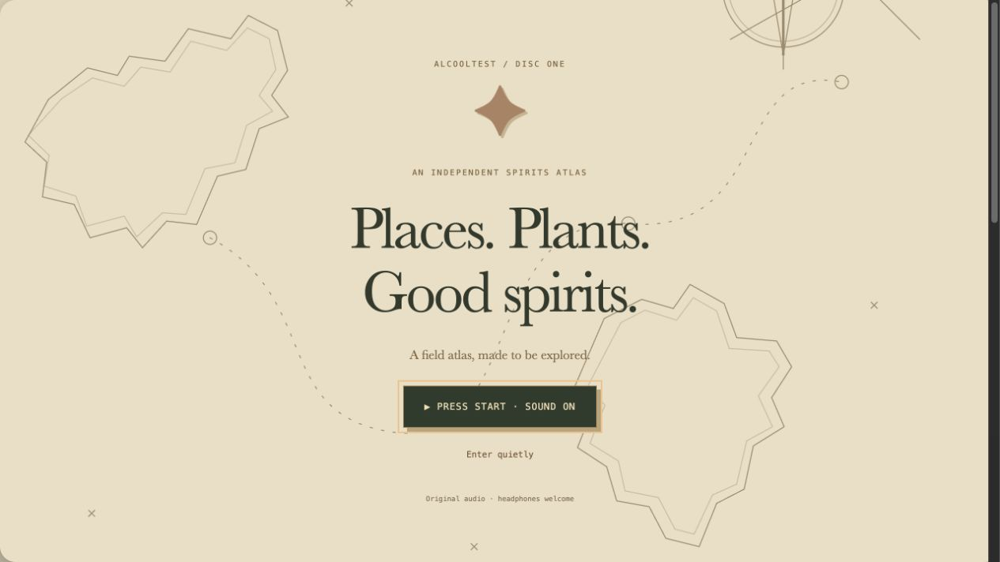
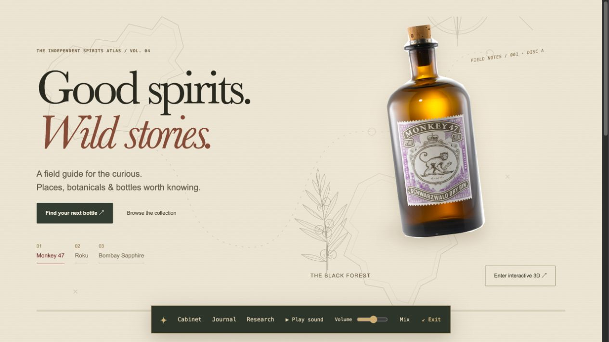
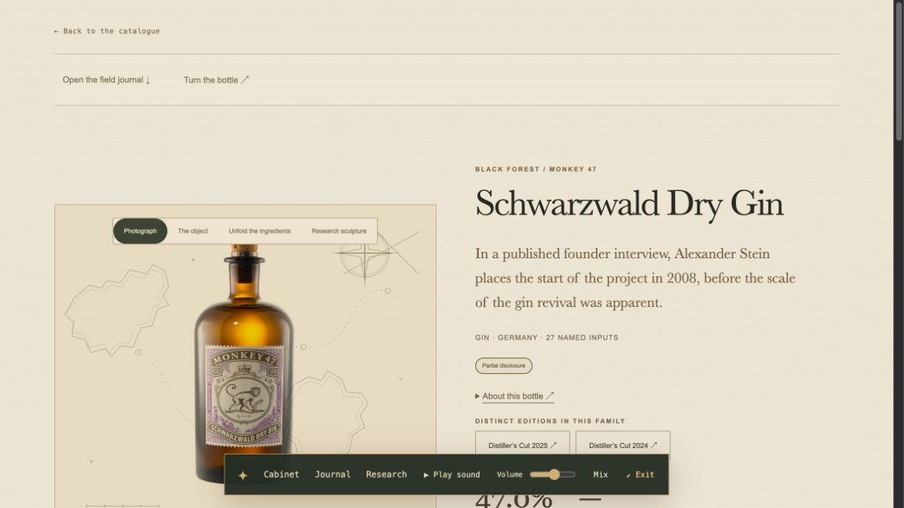
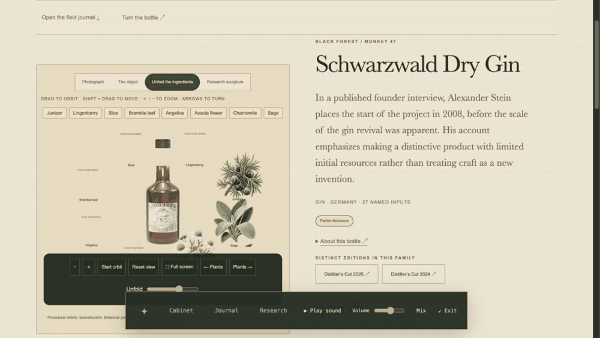
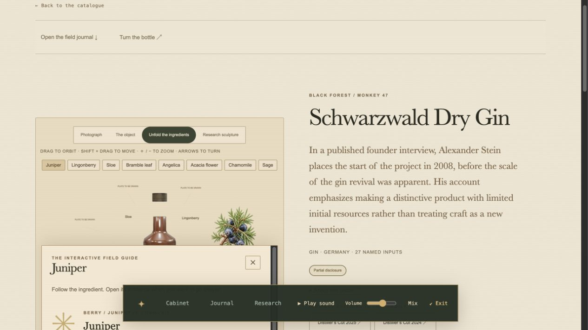
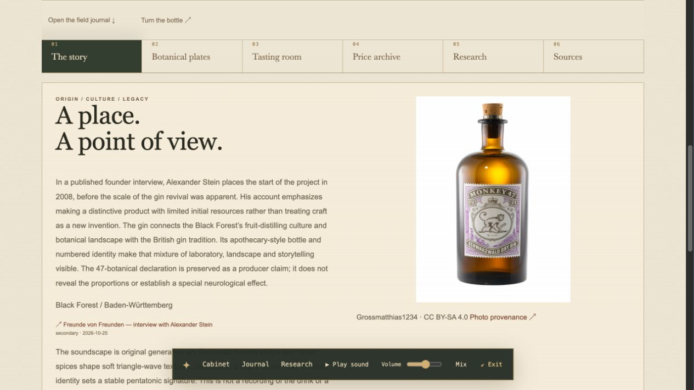
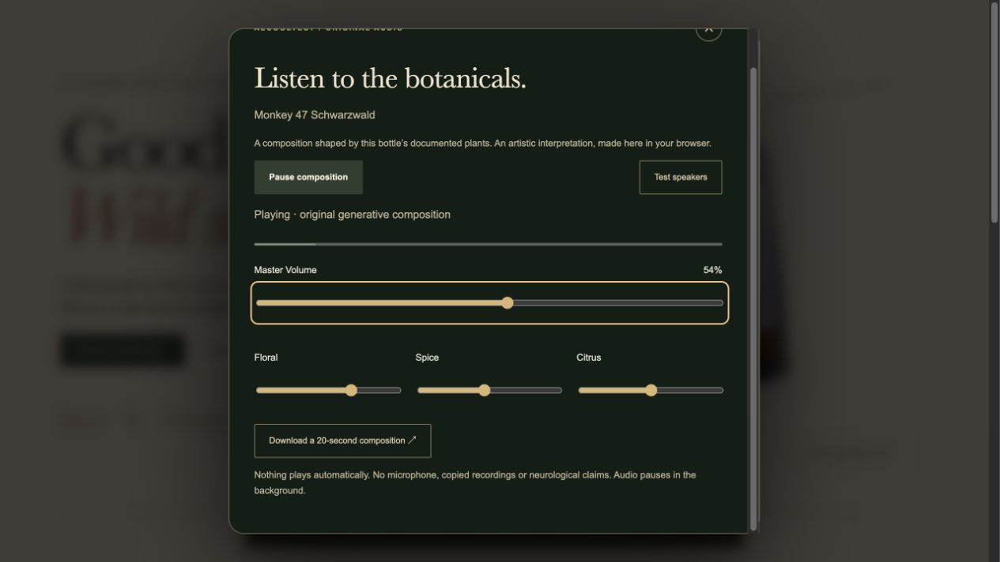
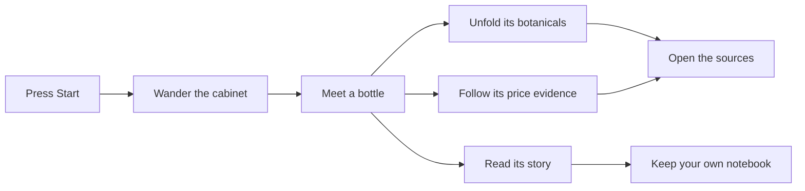
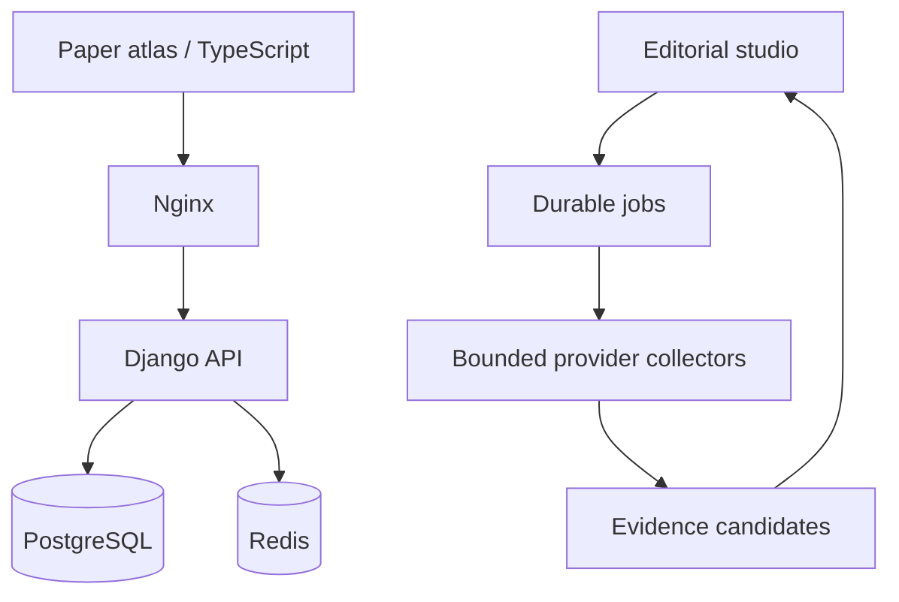

# Alcooltest° — insert curiosity



[](https://github.com/nabz0r/AlcooholTest/actions/workflows/ci.yml)

**An open spirits atlas with the soul of a discovery CD-ROM.** Warm paper. Botanical plates. Original sound. A cabinet to wander through, a field journal to open, and sources to follow.

**[Enter the tour ↓](#01--press-start)** · **[Listen to the atlas ♫](docs/media/monkey-47-composition.mp3)** · **[Open the data](data/catalog/)** · **[Run your own](#run-your-own-atlas)**

The cover above is original animated vector art. Everything photographed below is captured from the running Docker application. You can explore this README without launching a website; the live controls belong to the application.

## 01 / Press Start



Enter with sound or enter quietly. The atlas keeps its navigation and audio transport within reach. No surprise autoplay. No microphone. A quiet exit is always available.



## 02 / Follow a bottle



Meet the bottle first. Open its **Story**, **Botanical plates**, **Tasting room**, **Price archive**, **Research** or **Sources** when curiosity takes you there. Keyboard arrows move through the journal tabs. A product stays one product across sellers and bottle sizes.

## 03 / Move through the plates



Drag to orbit. Unfold the scene. Choose a plant by its name. Its field note opens inside the studio; its evidence waits one click deeper.

| The field note | The story |
|---|---|
|  |  |

Botanical plates are artistic illustrations, not specimen photographs. Undrawn plates are explicitly marked. The bottle object is procedural artwork with an illustrative label projection, not a scan or an authentic reconstructed rear label.

## 04 / Give the atlas a voice

**[▶ Listen to a real 20-second Monkey 47 composition](docs/media/monkey-47-composition.mp3)**



Floral tones, spice textures and citrus accents shape an original generative score. Product identity sets its musical signature. Start, pause, adjust the volume, open the mixer or export your own WAV. It is a creative interpretation of documented ingredient names—not the sound or biological effect of a drink.

The README links user-initiated audio and embeds animated image/vector media. It does not execute JavaScript, TypeScript or Angular inside GitHub Markdown. [How the media were made](docs/media/README.md).

## 05 / Keep a field journal

Save a wishlist, mark a bottle owned or tasted, add a **0–5 monkey** note, and describe aroma, taste, finish, value and design. Community notes and label photographs are moderated. Critic scores stay on their original scales. Private observation notebooks describe your own recorded transitions; they do not predict intoxication or neurological effects.



<details>
<summary><strong>See earlier discovery, comparison and voting captures</strong></summary>

These are historical Volume 03/02 captures of existing functionality, before the paper-atlas art direction. They are not current-theme screenshots.

| Discovery | Compare |
|---|---|
|  |  |

The [complete screenshot journal](docs/SCREENSHOTS.md) preserves dates, captions and integrity manifests.
</details>

## What the archive contains

| Documented now | What it means |
|---|---|
| **55 canonical bottles + 2 distinct editions** | Gin, rum, whisky, amaretto and other spirits; formats and sellers do not multiply products |
| **55 attributed histories** | Original editorial accounts with source links |
| **125 indexed ingredients / production inputs** | Plant parts, fermentation materials and blend inputs; this is not 125 proven active botanicals |
| **56 critic accounts** | Attributed summaries, separate from local monkey votes |
| **40 dated price observations** | 38 parsed retailer captures across five products, plus two Luxembourg observations; no daily reconstruction |
| **22 licensed reference photographs** | A genuine historical Heering front/rear pair is included; most rear labels remain missing |
| **9 curated studies** | Study-specific evidence; zero finished-bottle compound measurements |

**Twenty-year price coverage remains incomplete.** The executed archival dump currently spans 2007–2015; it is not a complete twenty-year series for every bottle. The UI exposes source captures, format, strength, seller, country and currency. Different markets, sizes, auction results and retailer offers must not be silently averaged. [Executed archive facts](data/prices/archive-research.json) · [Price methodology](docs/PRICES.md).

The archive is open-ended. A missing photograph, secret formula, unmeasured concentration or undocumented year stays a visible research task, not invented content.

## Run your own atlas

```sh
git clone https://github.com/nabz0r/AlcooholTest.git
cd AlcooholTest
./scripts/bootstrap.sh
```

Open **http://localhost:8088**. Public exploration needs no account. To own the instance, choose Set up instance, retrieve the one-time token with `./scripts/setup-token.sh`, and create the first administrator. There is no shared default password.

<details>
<summary><strong>For editors — maintain the living atlas</strong></summary>

The product admin provides a dossier workbench, missing-evidence filters, history/source editing, recipes, attributed criticism and licensed packaging contributions. Bottling pages include sourced price observations. Duplicate resolution previews changes and retains a canonical product.

The Studio queues JSON/JSONL/SQL exports, validates catalogue imports and runs bounded discovery/research/archive jobs. Wayback price candidates require an editor to confirm identity before acceptance; collection is not automatic publication. Public exports exclude accounts, member reviews, shelves, submitted photos and private observations. SQL backups are private and must stay out of Git.

[Editorial operations](docs/OPERATIONS.md) · [Identity rules](docs/IDENTITY.md) · [Data contracts](docs/DATA.md) · [Price archive](docs/PRICES.md)
</details>

<details>
<summary><strong>For builders — architecture and verification</strong></summary>

TypeScript / Three.js / Web Audio; Django 5.2 LTS; PostgreSQL 17; Redis 8; unprivileged Nginx. Docker publishes only the loopback web port. Read-only application filesystems, sessions/CSRF, Argon2, rate limits and audited editing form a practical baseline, not a security certification.



```sh
# Run PostgreSQL integration checks.
docker compose exec api python manage.py test catalog --noinput
# Rebuild the portable catalogue from reviewed inputs.
python3 scripts/build_seed.py
python3 scripts/build_data_exports.py
# Explicit reviewed reseed; restarts otherwise preserve editorial changes.
docker compose exec api python manage.py seed
```

Clean URLs, canonical metadata, JSON-LD, sitemap and robots are included. Configure the real HTTPS public origin before hosting. SSO and hybrid PQ transport are roadmaps, not deployed/certified features.

Code: GPL-2.0. Original catalogue work: CC0 where indicated. Images and source material retain their own rights; generated art is labelled. Redis 8 offers an AGPLv3 open-source option. No paid API or proprietary runtime is required.
</details>

## The next disc

**Android APK: roadmap only.** Gyroscope exploration, camera capture, permission/denial flows, calibration, privacy and physical-device acceptance gates are specified in [the Android delivery contract](docs/ANDROID-ROADMAP.md). No APK is represented as built or tested.

Expand the verified archival coverage, replace missing botanical plates and rear-label photographs, and deepen ingredient-specific research with explicit dose, route and measurement limits. [Plan](PLAN.md) · [Progress](PROGRESS.md).

## Open the documentation

[Art direction](docs/ATLAS-DESIGN.md) · [Botanical art](docs/BOTANICAL-ART.md) · [Experience](docs/EXPERIENCE.md) · [Science](docs/SCIENCE.md) · [Prices](docs/PRICES.md) · [Android](docs/ANDROID-ROADMAP.md)

[Architecture](docs/ARCHITECTURE.md) · [API](docs/API.md) · [Data](docs/DATA.md) · [Operations](docs/OPERATIONS.md) · [Ingestion](docs/INGESTION.md) · [SEO](docs/SEO.md)

[Validation](docs/VALIDATION.md) · [Screenshot journal](docs/SCREENSHOTS.md) · [Attribution](docs/ATTRIBUTIONS.md) · [Security](SECURITY.md) · [Contributing](CONTRIBUTING.md) · [Working agreement](AGENTS.md)
