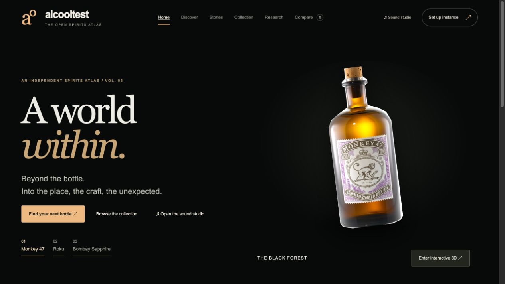
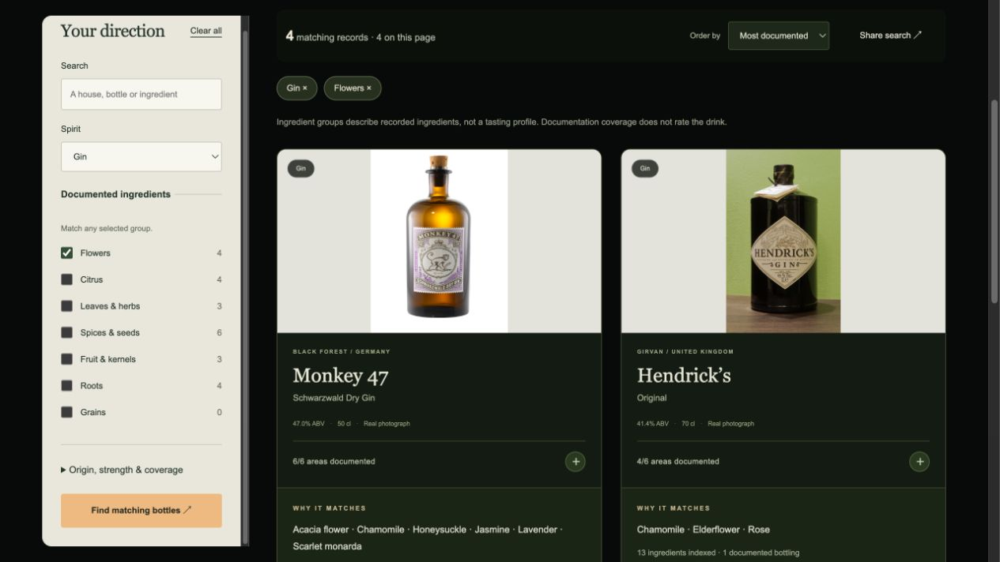
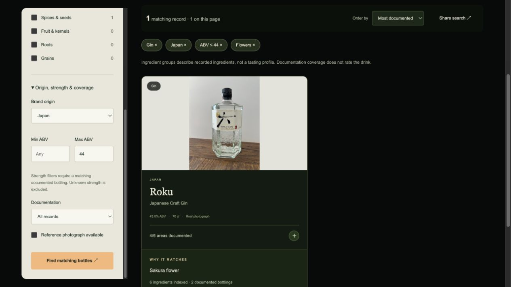
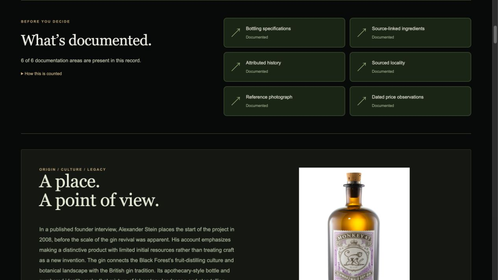
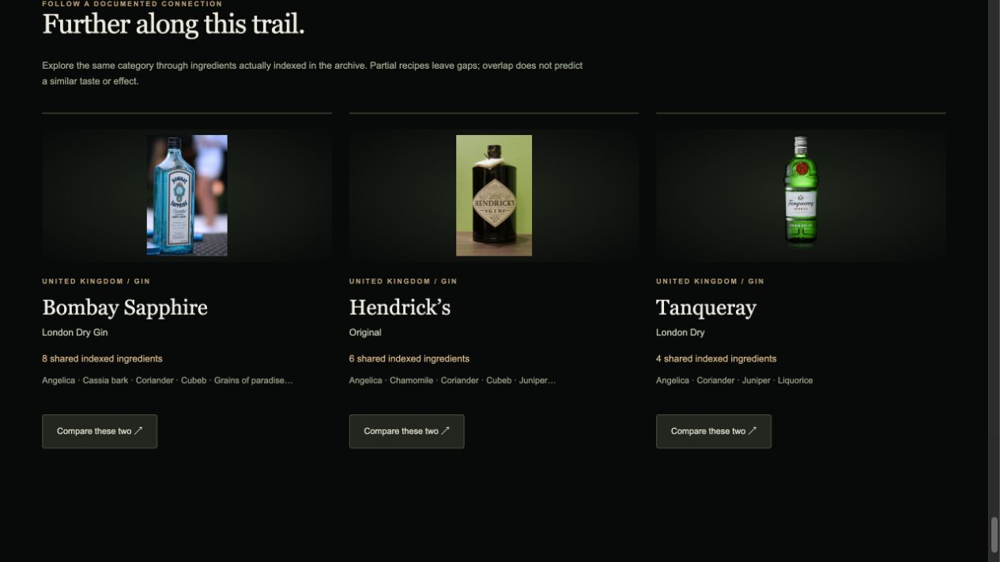
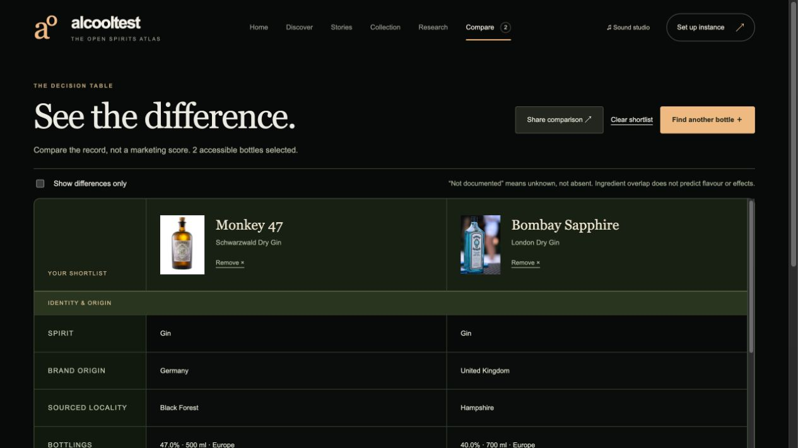
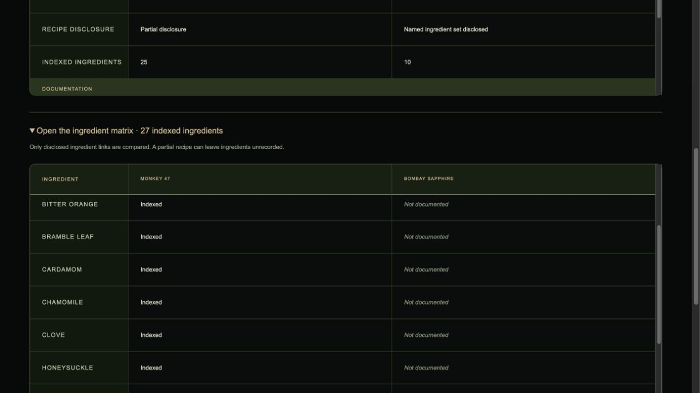
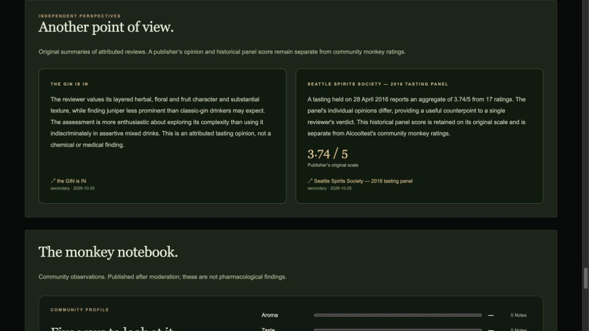
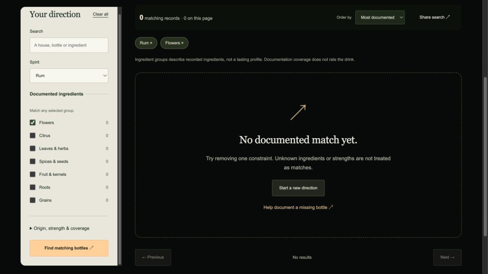

# Alcooltest

[](https://github.com/nabz0r/AlcooholTest/actions/workflows/ci.yml)

**A world within. A clearer way to choose.** An open-source, self-hosted spirits atlas with an evidence-led discovery desk, a shareable comparison table, documented ingredients and an artistic bottle studio.



## What you can actually do

- **Find a direction.** Filter canonical products by spirit, brand origin, editorial ingredient groups, a documented bottling's strength, photograph availability and six-area record coverage. See counts, remove applied constraints and share the exact search.
- **Understand each result.** Matched ingredient names explain why a record appears. Coverage describes what the record documents; it never rates the spirit. Unknown ingredients, strengths and prices stay unknown.
- **Compare the differences.** Select up to four bottles; align bottlings, origin, disclosure and documentation in a sticky-header matrix. Hide equal values, inspect an ingredient matrix, clear the shortlist and share a URL that reconstructs it.
- **Follow real connections.** Product alternatives name their shared indexed ingredients or explain a same-category fallback. A direct two-bottle comparison turns that connection into an inspectable decision.
- **Read another perspective.** Six attributed critic accounts include short original summaries and a separately labeled historical tasting-panel score. Publisher perspectives are never averaged with local community votes.
- **Explore the object.** Licensed real photos, packaging-view tabs, a zoomable label inspector and moderated photo proposals. An actual historical Heering front/rear pair is included; most reverse labels remain undocumented.
- **Explore the art.** Lazy-loaded procedural 3D, botanical explosion, an abstract Neuro atlas and opt-in generative botanical audio with a mixer, speaker test and WAV export. These are interpretations, not scans or measurements.
- **Keep your notebook.** Private shelves, moderated 0–5 monkey notes with optional tasting dimensions/tags/context, and private empirical state-transition records. There are no invented verified-purchase badges or product-specific pharmacological predictions.
- **Run the archive.** Admin editing, conservative duplicate preview/merge, UI imports/exports, durable jobs and executed bounded Wikidata/PubMed discovery dumps with provenance.

The collection has **55 canonical products + 2 distinct editions**, 48 brands, 69 indexed ingredients, 22 licensed reference photographs, 9 curated studies and 6 critic accounts. Forty expansion identities and the historical Heering identity remain incomplete in bottling/recipe detail. The distribution is not every public bottle or every secret formula. Two dated Luxembourg observations begin the price notebook; finished-product compound measurements remain zero.

## Run locally

Install Docker Engine/Desktop with Compose v2 and Python 3:

```sh
git clone https://github.com/nabz0r/AlcooholTest.git
cd AlcooholTest
./scripts/bootstrap.sh
```

Open **http://localhost:8088**. Public discovery works without an account. For ownership, choose Set up instance, retrieve the one-time token using `./scripts/setup-token.sh`, then create the first administrator in the UI. No shared default password exists. Only the loopback website port is published; PostgreSQL and Redis have no host port.

Try a [flower-ingredient discovery](http://localhost:8088/discover/?category=Gin&groups=floral), a [Japan / documented strength direction](http://localhost:8088/discover/?category=Gin&groups=floral&country=Japan&max_abv=44), or a [Monkey 47 / Bombay comparison](http://localhost:8088/compare/?bottles=monkey-47-schwarzwald%2Cbombay-sapphire&differences=1) after starting your instance.

## The decision desk, in real screenshots

Actual browser captures of the running Docker application. [Current and historical screenshot index](docs/SCREENSHOTS.md) includes captions, dimensions and checksums.

| | |
|---|---|
| **Explainable discovery**<br> | **A focused direction**<br> |
| **What the record documents**<br> | **Source-explained connections**<br> |
| **An aligned comparison**<br> | **Only the differences**<br> |
| **Ingredient-level inspection**<br> | **Attributed perspectives**<br> |



The earlier 18-view gallery is retained as explicitly labeled Volume 02 evidence in the screenshot index, including sound, fullscreen studios, packaging, detailed voting and administration. It is not presented as fresh Volume 03 capture.

## Architecture and data

Django 5.2 LTS / PostgreSQL 17 / Redis 8 / TypeScript / Three.js / unprivileged Nginx. Compose includes migration/static initialization, API, durable PostgreSQL-backed worker, database, cache and proxy. Read-only application filesystems, CSRF/session authentication, Argon2, rate limits and audited editing provide a practical baseline. Discovery uses bounded SQL queries, EXISTS-based coverage and revision-cached reads; imports are transactional UUID upserts and exports stream consistent snapshots.

Clean server-rendered URLs, canonical metadata, Open Graph, JSON-LD, sitemap and robots support public discovery. Set PUBLIC_BASE_URL to the actual HTTPS origin before public hosting. Member pages are noindex. SSO and hybrid PQ TLS remain documented deployment plans; independent security/WCAG certification is not claimed.

`data/catalog/` contains reproducible JSON, JSONL, schema and checksum manifests. `data/assets.json` preserves image rights and integrity. `data/navigation/` reproduces editorial group mappings and critic summaries. `data/discovery/` retains executed provider dumps. Public catalogue exports exclude accounts, member photos, reviews, shelves and private observations. Back up private SQL and media separately.

```sh
# Explicit reviewed reseed; ordinary restarts preserve editorial changes.
docker compose exec api python manage.py seed
# PostgreSQL integration suite.
docker compose exec api python manage.py test catalog --noinput
# Reproduce distributions from curated source inputs.
python3 scripts/build_seed.py
python3 scripts/build_data_exports.py
# Fetch pinned licensed image bytes, rejecting changed hashes.
python3 scripts/fetch_assets.py
```

Source code is GPL-2.0. Original catalogue work is CC0 where indicated; images retain their own licenses and trademarks. Redis 8 has an AGPLv3 open-source licensing option. No proprietary runtime or paid API is required.

## Documentation and working agreement

- [Decision rules, UX rationale and limits](docs/DECISIONS.md)
- [Experience](docs/EXPERIENCE.md), [Design](docs/DESIGN.md), [SEO and routes](docs/SEO.md)
- [Architecture](docs/ARCHITECTURE.md), [API](docs/API.md), [Data contracts](docs/DATA.md)
- [Identity and duplicates](docs/IDENTITY.md), [Discovery ingestion](docs/INGESTION.md)
- [Science and state notebook](docs/SCIENCE.md), [Price observations](docs/PRICES.md)
- [Operations and recovery](docs/OPERATIONS.md), [SSO/PQ roadmap](docs/SSO-PQC.md)
- [Validation evidence](docs/VALIDATION.md), [Screenshots](docs/SCREENSHOTS.md), [Attribution](docs/ATTRIBUTIONS.md)
- [Initial analysis](docs/ANALYSIS.md), [Security](SECURITY.md), [Contributing](CONTRIBUTING.md)
- [Plan](PLAN.md), [Progress](PROGRESS.md), [Repository working agreement](AGENTS.md)

Every work session records scope, verification and publication separately. Screenshots must show the running product; missing data and incomplete capabilities must remain explicit.
