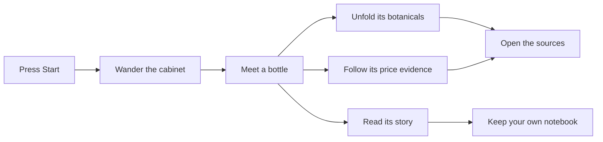
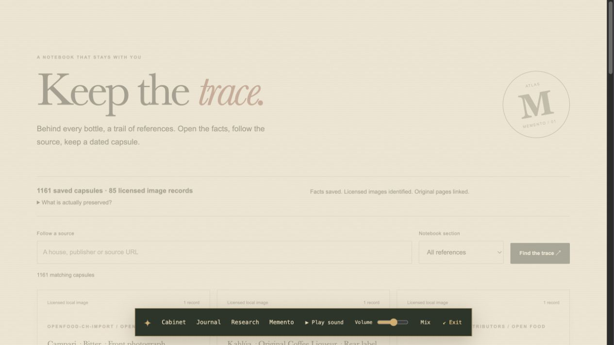
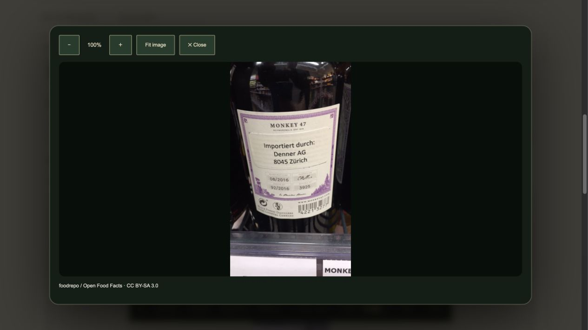
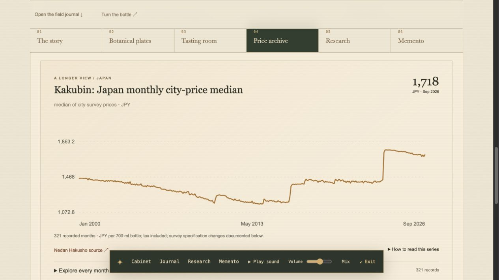
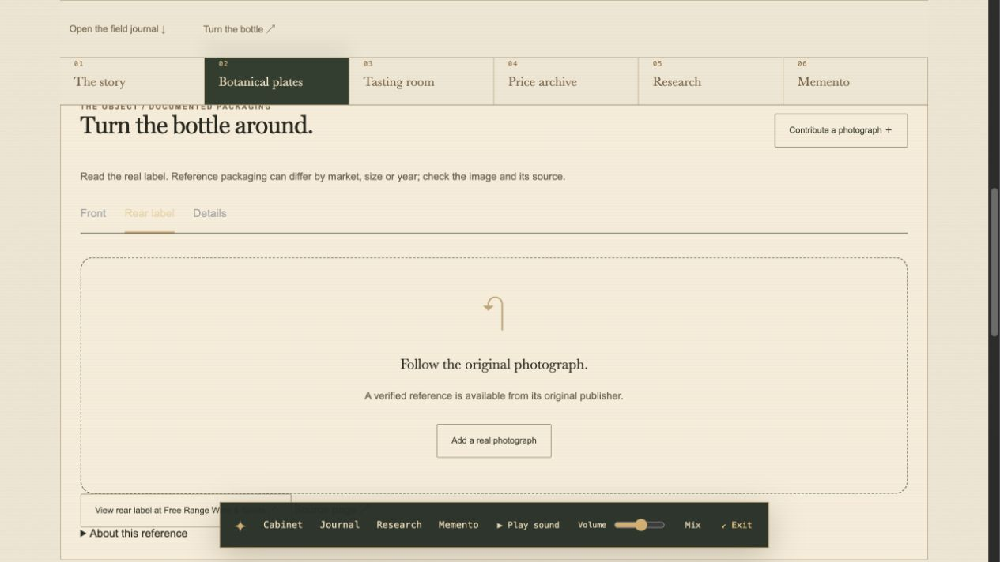
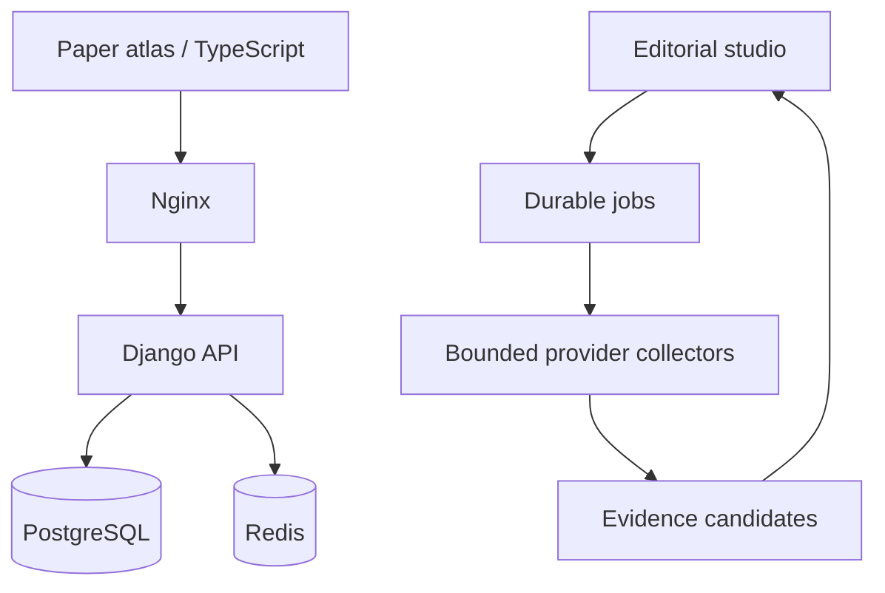

# Alcooltest° — insert curiosity


[](https://github.com/nabz0r/AlcooholTest/actions/workflows/ci.yml)

**An open spirits atlas with the soul of a discovery CD-ROM.** Warm paper. Botanical plates. Original sound. A cabinet to wander through, a field journal to open, and sources to follow.

**[Enter the tour ↓](#01--press-start)** · **[Listen to the atlas ♫](docs/media/monkey-47-composition.mp3)** · **[Keep the sources](#06--keep-the-sources)** · **[Open the data](data/catalog/)** · **[Run your own](#run-your-own-atlas)**

The cover above is original animated vector art. The application screenshots and motion captures below come from the running Docker application; their dated history is preserved in the screenshot journal. You can explore this README without launching a website; the live controls belong to the application.

## 01 / Press Start


Enter with sound or enter quietly. The atlas keeps its navigation and audio transport within reach. No surprise autoplay. No microphone. A quiet exit is always available.


## 02 / Follow a bottle


Meet the bottle first. Open its **Story**, **Botanical plates**, **Tasting room**, **Price archive**, **Research** or **Sources** when curiosity takes you there. Keyboard arrows move through the journal tabs. A product stays one product across sellers and bottle sizes.

## 03 / Move through the plates


Drag to orbit. Unfold the scene. Choose a plant by its name. Its field note opens inside the studio; its evidence waits one click deeper.

| The field note | The story |
|---|---|
|  |  |

Botanical plates are artistic illustrations, not specimen photographs. Undrawn plates are explicitly marked. The bottle object is procedural artwork with an illustrative label projection, not a scan or an authentic reconstructed rear label.

## 04 / Give the atlas a voice

**[▶ Listen to a real 20-second Monkey 47 composition](docs/media/monkey-47-composition.mp3)**


Floral tones, spice textures and citrus accents shape an original generative score. Product identity sets its musical signature. Start, pause, adjust the volume, open the mixer or export your own WAV. It is a creative interpretation of documented ingredient names—not the sound or biological effect of a drink.

The README links user-initiated audio and embeds animated image/vector media. It does not execute JavaScript, TypeScript or Angular inside GitHub Markdown. [How the media were made](docs/media/README.md).

## 05 / Keep a field journal

Save a wishlist, mark a bottle owned or tasted, add a **0–5 monkey** note, and describe aroma, taste, finish, value and design. Community notes and label photographs are moderated. Critic scores stay on their original scales. Private observation notebooks describe your own recorded transitions; they do not predict intoxication or neurological effects.



## 06 / Keep the sources

Open **Memento** to follow a bottle's references, open a compact fact capsule or keep a portable JSON copy. The source title, publisher, original link and recorded evidence travel together. An editor can regenerate the source archive and download a ZIP containing the public facts and licensed bottle images.

A capsule preserves what the atlas extracted and what its hash verifies. Full articles and retailer pages stay with their publishers. External photograph references remain source links. [Explore the Memento contract](docs/MEMENTO.md).

| Follow the evidence | Read the real label |
|---|---|
|  |  |
| Search the source cabinet and keep a dated fact capsule. | Open a licensed photograph, fit the image or zoom into its label. |

| Explore a longer history | Follow the original photograph |
|---|---|
|  |  |
| Kakubin's 321 survey months have their own context and specification notes. | When hosting permission is absent, the atlas opens the verified source. |

Take the [committed offline capsules](data/memento/snapshot.zip) and their [source index](data/memento/index.json): this metadata snapshot contains **1,160 capsules**. The live capture above shows **1,161**, including its current database research context; regenerated archives describe their own version. The admin ZIP also includes the **85 licensed local images**.

<details>
<summary><strong>See earlier discovery, comparison and voting captures</strong></summary>

These are historical Volume 03/02 captures of existing functionality, before the paper-atlas art direction. They are not current-theme screenshots.

| Discovery | Compare |
|---|---|
|  |  |

The [complete screenshot journal](docs/SCREENSHOTS.md) preserves dates, captions and integrity manifests.
</details>

## What the archive contains

| Documented now | What it means |
|---|---|
| **55 canonical bottles + 2 distinct editions** | Gin, rum, whisky, amaretto and other spirits; formats and sellers do not multiply products |
| **55 attributed histories** | Original editorial accounts with source links |
| **125 indexed ingredients / production inputs** | Plant parts, fermentation materials and blend inputs; this is not 125 proven active botanicals |
| **56 critic accounts** | Attributed summaries, separate from local monkey votes |
| **613 dated price observations** | 537 archived offers, 57 current offers, 12 launch recommendations, six published historical prices and one wholesale quote; all 55 canonical products have price evidence |
| **321 separate monthly Kakubin statistics** | January 2000–September 2026 city-survey medians; a survey series with documented specification changes, kept separate from individual bottle offers |
| **85 licensed local photographs** | 44 products with a hosted front, 22 with a hosted rear; credited source series and market/packaging notes |
| **Actual front and rear references for all 55** | Local images plus 51 verified external source links; external links do not imply permission to host the image |
| **9 curated studies** | Study-specific evidence; zero finished-bottle compound measurements |

**Historical evidence reaches back to 2001.** Twenty-nine products have observations spanning at least 20 years across their documented source contexts. Only five currently reach 20 years within a comparable series; an overall span can cross formats, sellers, countries and price levels. Twenty-three products are too young for a 20-year branded history: 21 have sourced post-2006 introductions, and two have owner-confirmed brand bounds with the expression's exact launch year still unknown. Kakubin has its separate monthly survey history; early bottle-price gaps remain visible for Kakubin, Four Roses Small Batch and Diplomático Reserva Exclusiva. No missing year is filled by interpolation. [Generated coverage](data/prices/coverage.json) · [Price methodology](docs/PRICES.md).

All 55 bottles have real front/rear **source evidence**, but 11 still lack a licensed local front and 33 lack a licensed local rear. Some photographs show historical or market-specific packaging. A source link, a hosted image pair and a procedural 3D object remain different things. [Photographic coverage](data/photography/coverage.json) · [Credits and rights](docs/ATTRIBUTIONS.md).

The archive is open-ended. A missing photograph, secret formula, unmeasured concentration or undocumented year stays a visible research task, not invented content.

## Run your own atlas

```sh
git clone https://github.com/nabz0r/AlcooholTest.git
cd AlcooholTest
./scripts/bootstrap.sh
```

Open **http://localhost:8088**. Public exploration needs no account. To own the instance, choose Set up instance, retrieve the one-time token with `./scripts/setup-token.sh`, and create the first administrator. There is no shared default password.

<details>
<summary><strong>For editors — maintain the living atlas</strong></summary>

The product admin provides a dossier workbench, missing-evidence filters, history/source editing, recipes, attributed criticism and licensed packaging contributions. **Photographs & price archives** brings all 55 canonical bottles into one desk: hosted-image gaps, external front/rear links, annual price evidence, comparable spans, editable collection targets and bounded collection jobs. Launch years and earliest possible brand dates are separate fields. Duplicate resolution previews changes and retains a canonical product.

The Studio queues JSON/JSONL/SQL exports, validates catalogue imports and runs bounded discovery/research/archive jobs. Wayback price candidates require an editor to confirm identity before acceptance; collection is not automatic publication. **Source Memento** queues public fact-capsule and licensed-image bundles. Public catalogue exports exclude accounts, member reviews, shelves, submitted photos and private observations. SQL backups are private and must stay out of Git.

[Editorial operations](docs/OPERATIONS.md) · [Identity rules](docs/IDENTITY.md) · [Data contracts](docs/DATA.md) · [Price archive](docs/PRICES.md) · [Source Memento](docs/MEMENTO.md)
</details>

<details>
<summary><strong>For builders — architecture and verification</strong></summary>

TypeScript / Three.js / Web Audio; Django 5.2 LTS; PostgreSQL 17; Redis 8; unprivileged Nginx. Docker publishes only the loopback web port. Read-only application filesystems, sessions/CSRF, Argon2, rate limits and audited editing form a practical baseline, not a security certification.



```sh
# Run PostgreSQL integration checks.
docker compose exec api python manage.py test catalog --noinput
# Rebuild the portable catalogue from reviewed inputs.
python3 scripts/build_seed.py
python3 scripts/build_data_exports.py
# Explicit reviewed reseed; restarts otherwise preserve editorial changes.
docker compose exec api python manage.py seed
```

Clean URLs, canonical metadata, JSON-LD, sitemap and robots are included. Configure the real HTTPS public origin before hosting. SSO and hybrid PQ transport are roadmaps, not deployed/certified features.

Code: GPL-2.0. Original catalogue work: CC0 where indicated. Open Food Facts-derived photographic metadata keeps ODbL/DbCL terms, and each image retains its recorded license and attribution. External reference photographs are linked at source. Generated art is labelled. Redis 8 offers an AGPLv3 open-source option. No paid API or proprietary runtime is required.
</details>

## The next disc

**Android APK: roadmap only.** Gyroscope exploration, camera capture, permission/denial flows, calibration, privacy and physical-device acceptance gates are specified in [the Android delivery contract](docs/ANDROID-ROADMAP.md). No APK is represented as built or tested.

Extend the remaining historical gaps, obtain permission or reusable images for missing local views, replace undrawn botanical plates and deepen ingredient-specific research with explicit dose, route and measurement limits. [Plan](PLAN.md) · [Progress](PROGRESS.md).

## Open the documentation

[Art direction](docs/ATLAS-DESIGN.md) · [Botanical art](docs/BOTANICAL-ART.md) · [Experience](docs/EXPERIENCE.md) · [Science](docs/SCIENCE.md) · [Prices](docs/PRICES.md) · [Source dates](docs/SOURCE_DATES.md) · [Memento](docs/MEMENTO.md) · [Android](docs/ANDROID-ROADMAP.md)

[Architecture](docs/ARCHITECTURE.md) · [API](docs/API.md) · [Data](docs/DATA.md) · [Operations](docs/OPERATIONS.md) · [Ingestion](docs/INGESTION.md) · [SEO](docs/SEO.md)

[Validation](docs/VALIDATION.md) · [Screenshot journal](docs/SCREENSHOTS.md) · [Attribution](docs/ATTRIBUTIONS.md) · [Security](SECURITY.md) · [Contributing](CONTRIBUTING.md) · [Working agreement](AGENTS.md)
