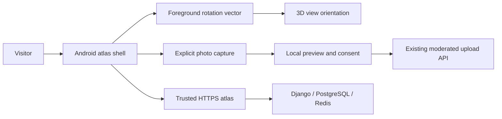

# Android atlas — delivery roadmap

**Status: planned, no APK built or validated.** The current deliverable is the Docker web atlas. This document is an implementation contract for a later Android APK, not evidence of a working mobile binary.

## The experience

Open the atlas as an immersive field journal. Sound starts with an explicit gesture, respects audio focus, pauses when backgrounded and remains controllable. A visitor can explore a bottle by touch or tilt, photograph its front/rear label, review the photo and submit it for editorial moderation. Refusing camera or motion access must preserve the complete browsing experience.

## Proposed architecture

Kotlin Android shell with a strictly allowlisted HTTPS WebView, using the same hosted atlas, session and API origin. Native CameraX is a later capture enhancement; an initial native file chooser can return a FileProvider content URI to the existing upload form. No arbitrary JavaScript/native bridge is part of the baseline. External research and retailer links open in a browser, outside the privileged atlas origin. Docker remains the backend deployment.

A sensor bridge, if needed, must use a versioned message schema, an exact origin allowlist, bounded finite quaternion values, no arbitrary code execution and no access from frames or external pages. Evaluate native WebView integration and authentication on a prototype before committing to it. Bundled offline assets would change the origin/session model and need a separate design; offline accounts and background uploads are not promised.

## Motion contract

- Prefer the game rotation vector for relative exploration where available; otherwise use the rotation vector. Hardware availability is checked at runtime.
- Recenter to a neutral pose; remap display rotation correctly; smooth orientation and limit camera excursion. Touch and reset remain available.
- Target at most 60 Hz; unregister listeners when the scene/activity is inactive. No high-sampling permission, location, health-sensor collection or background motion logging.
- Sensor data remains on the device. No sensor telemetry enters reviews, studies or Markov observations.
- Provide a visible Tilt on/off control and a reduced-motion alternative.

Android's sensor framework exposes device-specific availability and coordinate conventions; sampling above the platform limit requires a separate permission and is unnecessary here. [Android sensor guidance](https://developer.android.com/develop/sensors-and-location/sensors/sensors_overview), [AOSP rotation-vector definitions](https://source.android.com/docs/core/interaction/sensors/sensor-types).

## Camera and privacy contract

Ask for camera access only after Capture label is selected. Explain the purpose, handle denial and offer the system photo picker. Use app-private temporary files and content URIs, remove abandoned captures, strip location/EXIF metadata before upload, and show front/rear/detail, credit, rights and edition fields. Barcode/OCR may suggest a canonical product; a human confirms it. Never create a duplicate product automatically from another seller, size or label photo.

The server already validates image size/format and requires moderation; the APK must preserve those checks. No microphone permission is needed for playback. Do not request broad external-storage access or disable TLS checks.

## Milestones and acceptance gates

| Gate | Deliverable | Required evidence |
|---|---|---|
| A — shell | HTTPS atlas, deep links, Back, audio lifecycle | Emulator install/launch, route and authentication tests |
| B — motion | Calibrated tilt with touch fallback | Physical device with gyro, device without supported sensor, portrait/landscape and pause/resume |
| C — capture | Preview, permissions, metadata removal, moderated upload | Physical camera, denial, cancellation, oversize/corrupt file and offline recovery |
| D — release | Signed APK and reproducible build instructions | Signature/manifest verification, SHA-256, fresh install and upgrade, screenshots and dependency audit |

Before implementation, verify current supported Android/Gradle/Kotlin/CameraX versions and the applicable distribution target SDK. Keep signing material outside Git; the owner retains the release key. APK delivery is complete only after installation, launch, real camera and real gyro validation—not after a successful build alone. Device testing and store publication are separate gates. No Google Play listing or 2030/PQ certification is claimed.

## Reference documentation

- [CameraX overview](https://developer.android.com/media/camera/camerax)
- [Request runtime permissions](https://developer.android.com/training/permissions/requesting)
- [Secure file sharing with FileProvider](https://developer.android.com/training/secure-file-sharing)
- [WebView native bridge risks](https://developer.android.com/privacy-and-security/risks/insecure-webview-native-bridges)
- [Photo picker](https://developer.android.com/training/data-storage/shared/photopicker)
