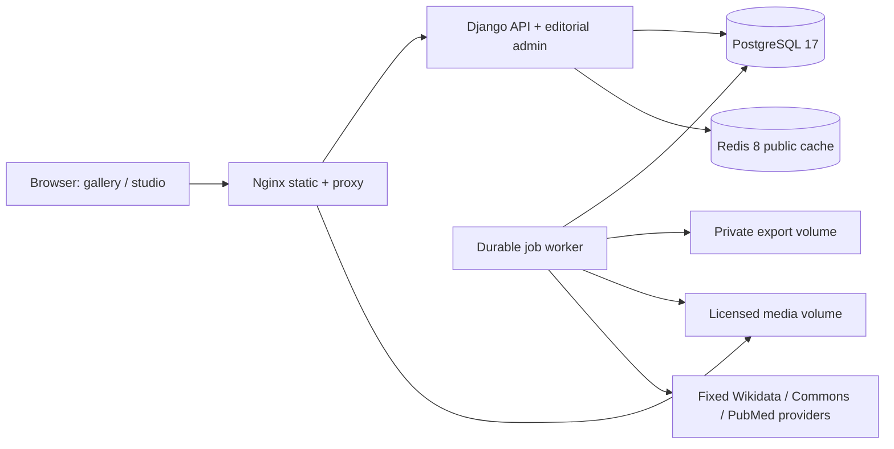

# Architecture

Nginx exposes one loopback port, serves Vite assets and curated photographs, overwrites peer IP headers and proxies API/admin on the same origin. Django provides sessions/CSRF and authoritative validation. PostgreSQL is the durable source of catalogue, identity, price, user and queue data. Redis is disposable caching, not a job broker or system of record. The worker claims jobs with row locking/skip_locked and stores UUID-named artifacts with checksums; jobs never interpolate a user-supplied shell command.

Initialization runs migrations, static collection and seeds only an empty database. Ordinary restarts preserve editorial changes. Explicit seed/import operations upsert known UUIDs transactionally and do not delete omitted rows. Seed upgrades therefore require deliberate reconciliation of superseded assertions. Structured public exports use a consistent repeatable-read transaction and streaming database iterators; SQL recovery includes private tables and requires secure handling. Media is backed up separately.

## Normalized identity

Source → assertion, Brand → Product → Variant, Product → Recipe → RecipeIngredient, Ingredient → IngredientCompound → Compound → Study/Mechanism. Place and licensed BottleAsset supply contextual presentation. PriceObservation belongs to a Variant, never a brand-wide mixed price. Product.edition_of links a distinct release to a canonical family. Product.merged_into keeps an archived duplicate as a traceable alias. Discovery candidates have unique provider/external IDs and an optional canonical resolution. See IDENTITY.md before importing at scale.

Composite indexes cover public product lookup and price series. PostgreSQL pg_trgm indexes on uppercase search fields support Django's case-insensitive substring predicates. Keyset UUID pagination avoids increasing OFFSET costs. Public response keys incorporate a revision changed after editorial transactions; TTL is 60 seconds. Redis failures fall back to uncached reads. Full-scale throughput, memory and query behavior must be measured against representative data rather than inferred from the starter catalogue.

## Assets and interaction

The initial UI loads system fonts, local photos and a small application bundle. Three.js and its studio controls are lazy-loaded. Glass/liquid/cap/labels and plant sculptures are procedural. Real reference photos are separate and attributed; none of the models claims scanned geometry or anatomical fidelity. Web Audio is locally generated and opt-in. Keyboard, text and reduced-motion alternatives retain catalogue access without an immersive session.

## Deployment boundaries

Containers are unprivileged where practical, drop capabilities and use read-only application filesystems. Only required volumes are writable. Database/Redis remain on a private network; API and worker have outbound network access for integrations. The default database account owns its schema so migrations and backups work locally; separate migrator/runtime roles are an explicit production improvement. There is no public TLS termination, SSO or post-quantum TLS configuration by default. See SSO-PQC.md and SECURITY.md.

Public document requests now pass through Django for server-rendered text, metadata and canonical redirects. Nginx still serves local bottle images and the Vite bundles. Stable app/CSS entries are revalidated, while content-hashed dependency chunks are immutable. Member packaging uploads share the existing media volume; BottlePhoto moderation and richer Review fields live in PostgreSQL. Redis revision invalidation includes approved-photo/review changes. Canonical merges move member photo relations and retain an audit trail.

Volume 03 adds a decision layer in catalog/discovery.py: SQL EXISTS coverage annotations, bounded canonical discovery, disjunctive ingredient-group facets, same-bottling strength constraints and source-explained overlap. Approved member front photos participate in public card selection through a per-parent limited prefetch. The frontend decision.ts module owns discovery, coverage and matrix rendering. Existing JSON interchange includes the additive navigation_group field; admin changes invalidate the same public cache revision.
